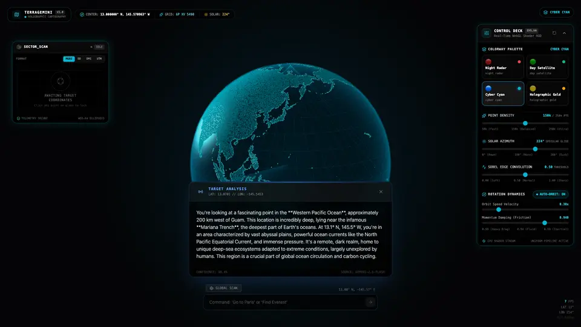
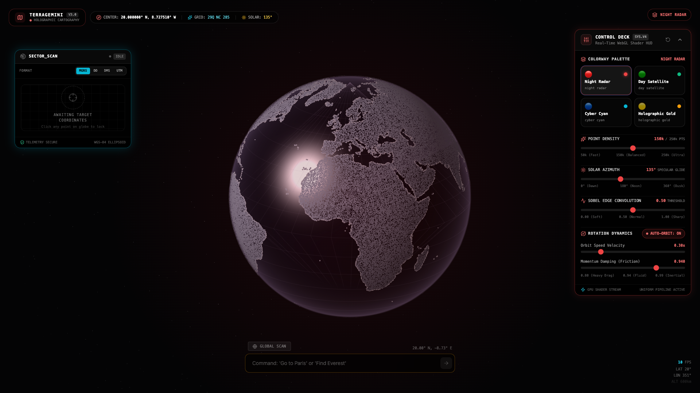
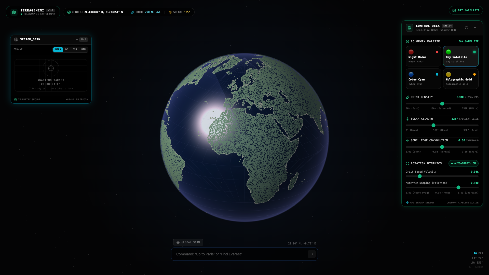
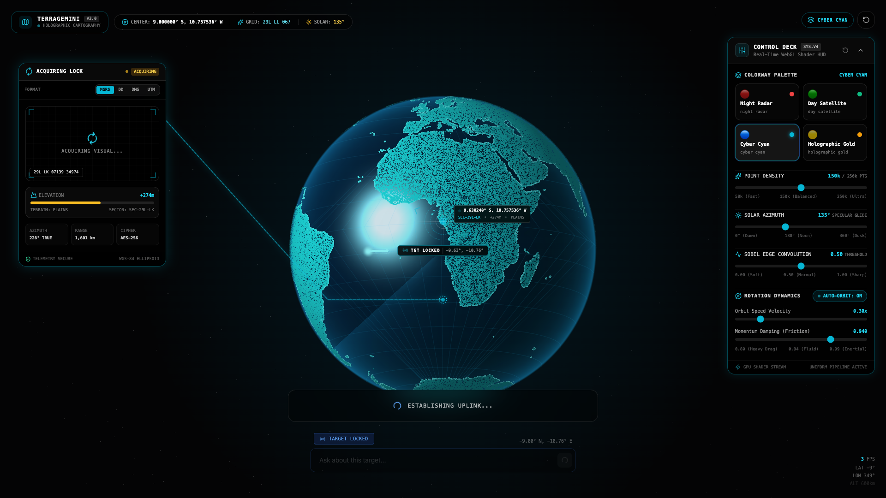
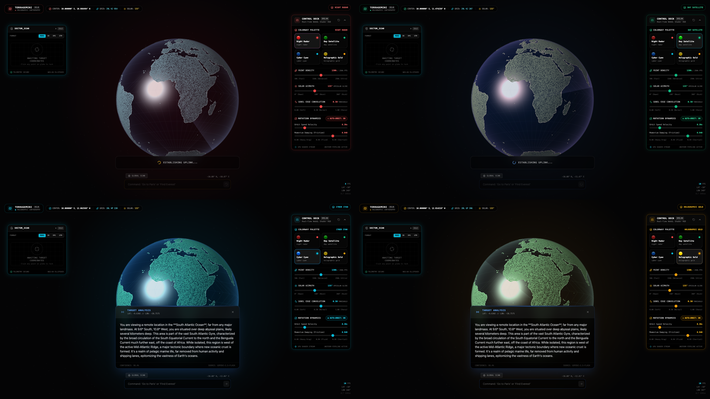

# TerraGemini — Holographic WebGL Planetary Telemetry & Cartography

> **Part of the [Cartography Featured Project](https://andrewvoirol.com/work/cartography) on [andrewvoirol.com](https://andrewvoirol.com) • [Live Interactive Lab](https://andrewvoirol.com/lab/terragemini)**

TerraGemini is an interactive, browser-based WebGL holographic planetary cartography and tactical telemetry system. Engineered from raw GLSL shaders and React 19 without third-party 3D engines, it renders a dynamic dot-matrix globe sampled from 50m TopoJSON geographic data, complete with real-time Blinn-Phong ocean specular glint, $3 \times 3$ Sobel coastline convolution, military coordinate telemetry (MGRS, UTM, DD, DMS), and interactive 3D target lock tracking.

## Quick Start

```bash
git clone https://github.com/AndrewVoirol/ais-terragemini.git
cd ais-terragemini
npm install
npm run dev
```

*Optional*: Add a Google Gemini API key to `.env.local` to enable natural language location search and satellite telemetry intelligence cards (`VITE_GEMINI_API_KEY=your_key_here`). The WebGL globe, shader control deck, and tactical coordinate engines operate 100% offline.

## Interactive Features

- **Dynamic Point Cloud Scaling (50k–250k)**: Real-time slider adjusting surface point density from 50,000 to 250,000 points with $O(1)$ GPU vertex buffer slicing and zero CPU re-rasterization.
- **Solar Specular Ocean Glide**: Scrubbable solar angle uniform driving a 2K Blinn-Phong specular ocean reflection $((\mathbf{N} \cdot \mathbf{H})^{38})$ and Rayleigh limb scattering across oceanic regions.
- **4 Instant Colorway Presets**: Zero-recompile uniform vector interpolation across four visual presets:
  - 🔴 **Night Radar**: Crimson glow, obsidian oceans, high-contrast tactical radar sweep.
  - 🟢 **Day Satellite**: Natural atmospheric limb scattering, vibrant specular oceans, topographic illumination.
  - 🔵 **Cyber Cyan**: Tron-style holographic neon, tactical graticule gridlines, high-contrast cyan landmasses.
  - 🟡 **Holographic Gold**: Amber vector aesthetic with warm atmospheric corona and solar specular flare.
- **Sobel Coastline Convolution**: Real-time slider modulating a $3 \times 3$ normal gradient edge threshold to sharpen coastal boundaries and maritime borders.
- **Precision Military Telemetry**: Live cursor hover readout and raycast click tracking across Military Grid Reference System (MGRS 1m precision), Universal Transverse Mercator (UTM), Decimal Degrees (DD), and Degrees-Minutes-Seconds (DMS).
- **3D Target Reticle & Lock Rings**: Geographic target pinning with 3D-to-2D forward projection, back-hemisphere occlusion culling, dynamic SVG leader line, and locked telemetry cards.
- **Damped Momentum Physics**: Smooth touch and pointer drag rotation with inertia decay and toggleable auto-orbit controls.

## How It Works

1. **Orbit & Inspect**: Click and drag the globe to rotate across pitch and yaw. Use the mouse wheel or pinch gesture to zoom. Toggle auto-orbit in the control deck.
2. **Tune Shaders**: Expand the floating glassmorphic Control Deck to scrub point density, adjust the sun's azimuth angle to slide the specular ocean glare, modulate Sobel coastline sharpness, or switch colorway presets instantly.
3. **Target Telemetry**: Hover anywhere over the globe for real-time geodetic coordinate and elevation readouts. Click any landmass or ocean to drop an animated target lock ring with dynamic SVG leader lines and MGRS coordinate tracking.
4. **Natural Language Uplink**: Enter queries into the uplink terminal (*"Find Tokyo"*, *"Locate the Mariana Trench"*, *"Scan Gibraltar"*) to trigger automated camera flight and geographical intelligence synthesis.

Behind the scenes, 50m TopoJSON land polygons are rasterized onto a 4K equirectangular matrix, sampled via cosine rejection sampling ($\propto \cos(\text{lat})$) into 250,000 pre-ranked vertex attributes, and rendered through multi-pass GLSL shaders with alpha blending and spherical raycasting.

## Screenshot Gallery

| Night Radar (`screenshots/night-mode.png`) | Day Satellite (`screenshots/day-specular.png`) |
|:---:|:---:|
|  |  |
| **Tactical Target HUD (`screenshots/target-hud.png`)** | **Palette Matrix (`screenshots/palette-matrix.png`)** |
|  |  |

## Tech Stack

| Layer | Technology | Purpose & Implementation |
|---|---|---|
| **UI Framework** | React 19 | Modular component tree, hooks architecture, and state lifecycle management |
| **Language** | TypeScript 5.8 | Strict type safety across geodetic math, WebGL uniforms, and component props |
| **Rendering Engine** | Raw WebGL / GLSL | Custom vertex & fragment shaders (no Three.js), multi-pass draw pipeline |
| **Cartography & Topo** | `d3-geo` + `topojson-client` | 50m Natural Earth topology extraction and 4K equirectangular projection |
| **Styling & HUD** | Tailwind CSS 3 | Glassmorphic HUDs, responsive telemetry cards, and dynamic theme tokens |
| **Build & Tooling** | Vite 6 | Sub-second HMR and optimized production bundling |
| **Coordinate Systems** | Custom Math Engine | High-precision WGS84 geodetic transformations to MGRS, UTM, DD, and DMS |
| **AI Intelligence** | Google Gemini 2.5 Flash | Satellite intelligence card generation and geographic natural language query resolution |
| **Icons & UI Assets** | Lucide React | Tactical HUD indicators, compass dials, and telemetry icons |

## Deep WebGL Shader Pipeline Architecture

TerraGemini implements a multi-pass WebGL rendering pipeline operating directly on an HTML5 canvas. Below is the mathematical and architectural breakdown of the four core rendering stages.

```
┌─────────────────────────────────────────────────────────────────────────────────────────────┐
│ 1. 4K Geographic Rasterization & Cosine Rejection Point Cloud Sampling                       │
│    50m TopoJSON ──► 4096x2048 Canvas ──► Cosine Rejection P(lat) ∝ cos(lat) ──► 250k Points  │
└──────────────────────────────────────────────┬──────────────────────────────────────────────┘
                                               │ [lon, lat, edge_strength, rank]
                                               ▼
┌─────────────────────────────────────────────────────────────────────────────────────────────┐
│ 2. WebGL Multi-Pass Shader Execution Pipeline                                                │
│                                                                                             │
│  [Pass 1: Deep Starfield]  ──► 2,000 billboard stars at 2.8x scale                           │
│  [Pass 2: Raytraced Ocean] ──► Blinn-Phong Specular (N·H)^38 + Limb Scattering + Radar Sweep │
│  [Pass 3: Graticule Grid]  ──► 10° latitude/longitude wireframe lines with z-depth culling   │
│  [Pass 4: Land Point Cloud]──► O(1) Slice [0..N], Sobel Edge Boost, Solar Diffuse Lighting   │
│  [Pass 5: Target Reticle]  ──► 3D Animated Pin, Surface Beacon & Dynamic SVG Leader Line   │
└──────────────────────────────────────────────┬──────────────────────────────────────────────┘
                                               │ Screen Pixels (NDC)
                                               ▼
┌─────────────────────────────────────────────────────────────────────────────────────────────┐
│ 3. Spherical Projection & Tactical Telemetry Engine                                         │
│    Screen Raycast (mx, my) ◄──► Unit Sphere (rx, ry, rz) ◄──► WGS84 Geodetic (Lat, Lon)      │
│    Lat/Lon ──► Military Grid Reference System (MGRS 1m Precision) + UTM Zone Calculations    │
└─────────────────────────────────────────────────────────────────────────────────────────────┘
```

### 1. 4K Equirectangular Canvas Rasterization & Cosine Rejection Sampling

On an equirectangular projection grid of dimensions $W \times H$, the differential surface area element $dA$ on a sphere of radius $R$ corresponds to:
$$dA = R^2 \cos(\phi) \, d\phi \, d\lambda$$
Sampling grid cells uniformly in latitude $\phi$ and longitude $\lambda$ leads to severe point over-concentration at polar regions. To achieve uniform spherical point density across all latitudes without geometric distortion, TerraGemini applies **Cosine Rejection Sampling**:

```typescript
// Probability of accepting a candidate point at latitude lat:
const lat = 90 - (y / height) * 180;
if (Math.random() > Math.cos(lat * (Math.PI / 180))) {
  continue; // Reject sample to preserve uniform area density
}
```

Points are assigned a composite importance rank:
$$\text{Rank}_i = 0.65 \cdot S_{\text{edge}} + 0.35 \cdot \xi, \quad \xi \sim \mathcal{U}(0, 1)$$
where $S_{\text{edge}} \in [0, 1]$ represents the Sobel boundary gradient magnitude. Candidates are sorted in descending order of $\text{Rank}_i$ and stored in a static 16-byte interleaved vertex buffer `[lon, lat, edge_strength, rank]`.

**$O(1)$ GPU Vertex Buffer Slicing**: When the user adjusts the Point Density slider between $50{,}000$ and $250{,}000$ points, the application updates the draw range count directly in the WebGL draw call:
```typescript
const renderPoints = Math.min(activeCount, countsRef.current.dots);
gl.drawArrays(gl.POINTS, 0, renderPoints);
```
This guarantees zero CPU re-rasterization, zero GPU buffer re-allocation, and instantaneous 60 FPS slider response.

### 2. Blinn-Phong Specular Ocean Reflection Shader

The oceanic surface is rendered via a raytraced billboard quad covering the screen-space bounding box of the sphere. For each fragment with normalized screen-relative coordinate $(u, v)$:

1. **Sphere Intersection & Normal Reconstruction**:
   $$r^2 = u^2 + v^2$$
   If $r^2 > 1.0$, the fragment misses the globe and is discarded via `discard`. Otherwise, the surface normal $\mathbf{N}$ is derived analytically:
   $$\mathbf{N} = \begin{pmatrix} u \\ -v \\ \sqrt{1.0 - r^2} \end{pmatrix}$$
2. **Solar Lighting & Half-Angle Calculation**:
   Given sun direction vector $\mathbf{L} = \frac{\mathbf{u}_{\text{sun}}}{\|\mathbf{u}_{\text{sun}}\|}$ and camera view vector $\mathbf{V} = (0, 0, 1)^T$, the Blinn-Phong half-angle vector $\mathbf{H}$ is:
   $$\mathbf{H} = \frac{\mathbf{L} + \mathbf{V}}{\|\mathbf{L} + \mathbf{V}\|}$$
3. **Glint & Specular Power**:
   $$I_{\text{spec}} = (\max(\mathbf{N} \cdot \mathbf{H}, 0.0))^{38} \cdot \mathcal{H}(\mathbf{N} \cdot \mathbf{L})$$
   where $\mathcal{H}(x)$ is the Heaviside step function ensuring that back-facing regions receive zero specular glint.
4. **Rayleigh Limb Scattering & Radar Sweep**:
   Atmospheric horizon glow is computed via inverted depth power:
   $$I_{\text{limb}} = (1.0 - z)^{2.6}$$
   The tactical radar sweep is modulated in polar coordinates:
   $$I_{\text{sweep}} = \exp\left(-\Delta\theta \cdot 3.5\right) \cdot u_{\text{radar\_sweep}}$$

```glsl
// Ocean Fragment Shader Glint Calculation
float NdotL = max(dot(N, L), 0.0);
float NdotH = max(dot(N, H), 0.0);
float spec = pow(NdotH, 38.0) * step(0.001, NdotL);
float limb = pow(1.0 - z, 2.6);

vec3 baseColor = u_color_ocean.rgb * (0.18 + 0.82 * NdotL);
vec3 specularColor = u_color_specular.rgb * (spec * 1.85);
vec3 atmosColor = u_color_atmos.rgb * (limb * 0.75 + sweep * 0.35);

gl_FragColor = vec4(baseColor + specularColor + atmosColor, u_color_ocean.a * smoothstep(1.0, 0.985, sqrt(r2)));
```

### 3. $3 \times 3$ Sobel Gradient Convolution Kernel

During the 4K rasterization phase, a discrete 2D spatial convolution is applied across the binary landmask image to extract coastline boundary gradients:

$$G_x = \begin{bmatrix} -1 & 0 & 1 \\ -2 & 0 & 2 \\ -1 & 0 & 1 \end{bmatrix}, \quad G_y = \begin{bmatrix} -1 & -2 & -1 \\ 0 & 0 & 0 \\ 1 & 2 & 1 \end{bmatrix}$$

$$\|\nabla I(x, y)\| = \frac{\sqrt{G_x(x, y)^2 + G_y(x, y)^2}}{4.0}$$

In the vertex shader `VS_DOTS`, the `u_edge_sensitivity` uniform dynamically shifts the activation threshold:
$$\text{Threshold} = 1.0 - (u_{\text{edge\_sensitivity}} \cdot 0.85 + 0.08)$$
$$\text{Factor}_{\text{edge}} = \text{smoothstep}(\text{Threshold}, 1.0, a_{\text{edge\_strength}})$$
$$\text{PointSize} = \text{clamp}\left(s_{\text{base}} \cdot \text{Fresnel} \cdot (1.0 + 1.6 \cdot \text{Factor}_{\text{edge}} \cdot u_{\text{edge\_sensitivity}}), 1.0, 64.0\right)$$

This allows real-time interactive sharpening of coastlines and continental shelves without re-filtering the geometry.

### 4. 3D Spherical Forward Projection & Screen Raycast Unprojection Math

#### Forward Projection (3D Sphere $\to$ 2D Screen)
To map any geodetic coordinate $(\phi, \lambda)$ at normalized altitude $h$ to screen coordinates $(x_s, y_s)$:
1. Convert to 3D Cartesian coordinates on sphere of radius $R = 1 + h$:
   $$\mathbf{p} = \begin{pmatrix} R \cos\phi \sin\lambda \\ R \sin\phi \\ R \cos\phi \cos\lambda \end{pmatrix}$$
2. Apply Euler camera rotations around Y (yaw $\theta_y$) and X (pitch $\theta_x$):
   $$\mathbf{p}' = R_x(\theta_x) \, R_y(\theta_y) \, \mathbf{p}$$
3. Project to canvas pixel coordinates:
   $$x_s = c_x + p'_x \cdot S, \quad y_s = c_y - p'_y \cdot S$$
   where $(c_x, c_y)$ is the viewport center, $S$ is the pixel scale factor, and $p'_z > 0$ defines front-hemisphere visibility.

#### Inverse Raycasting (2D Screen $\to$ 3D Sphere)
When the user clicks or hovers at canvas pixel $(x, y)$:
1. Compute normalized offset from viewport center:
   $$r_x = \frac{x - c_x}{S}, \quad r_y = -\frac{y - c_y}{S}$$
2. Check sphere intersection: if $r_x^2 + r_y^2 > 1.0$, the cursor misses the planet.
3. Compute forward depth component: $r_z = \sqrt{1.0 - (r_x^2 + r_y^2)}$.
4. Invert camera rotations in reverse order:
   $$\mathbf{p}_{\text{world}} = R_y(-\theta_y) \, R_x(-\theta_x) \begin{pmatrix} r_x \\ r_y \\ r_z \end{pmatrix}$$
5. Recover geodetic latitude and longitude:
   $$\phi = \arcsin\left(\text{clamp}(p_y, -1, 1)\right), \quad \lambda = \operatorname{atan2}(p_x, p_z)$$

---

## License

MIT License. Designed and engineered by Andrew Voirol.
