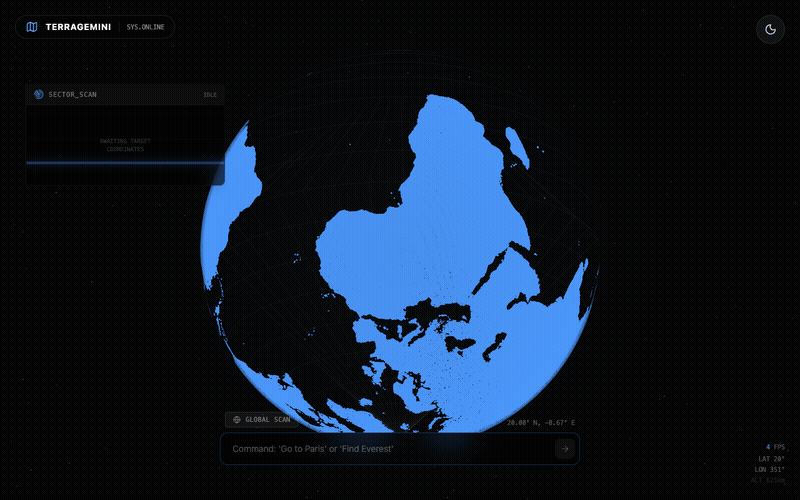
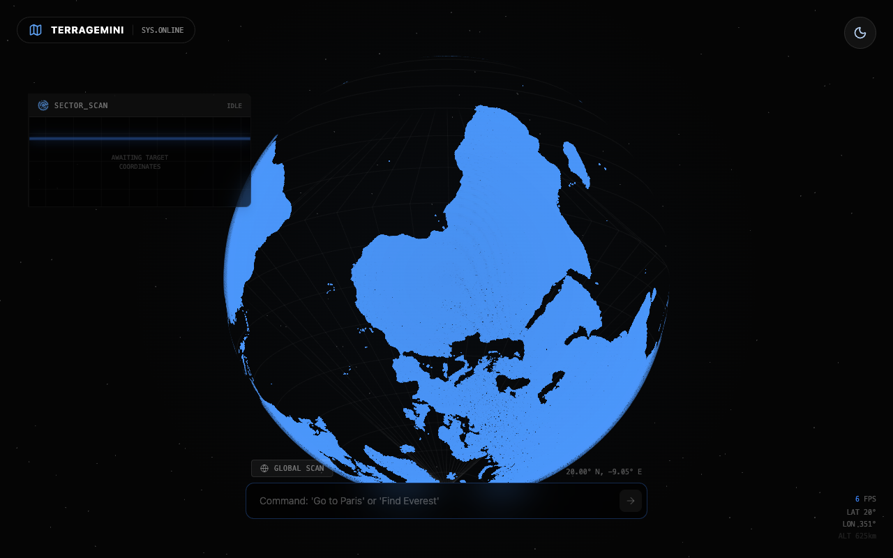
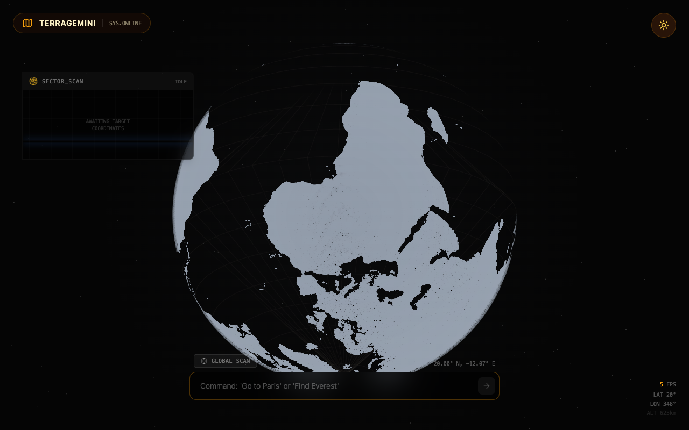

<div align="center">



</div>

# TerraGemini

A sci-fi satellite uplink simulator disguised as a geography app. Drag a custom WebGL globe rendered as a dot-matrix hologram, click any point on Earth or type natural language queries like *"Find Everest"* — Gemini flies the camera there, generates geographical insights, and produces a stylized satellite image of the location. Complete with a BIOS boot sequence and day/night mode.

## Quick Start

```bash
git clone https://github.com/AndrewVoirol/ais-terragemini.git
cd ais-terragemini
npm install
npm run dev
```

Add your Gemini API key in `.env.local` to enable AI features (the globe works without it):

```
VITE_GEMINI_API_KEY=your_key_here
```

Get a key → [aistudio.google.com/apikey](https://aistudio.google.com/apikey)

## How It Works

1. **Explore** — drag the globe to rotate, scroll to zoom, click any landmass to pin a location
2. **Search** — type a place name or question in the command bar (*"Go to Tokyo"*, *"What ocean is this?"*)
3. **Analyze** — Gemini resolves coordinates, generates an intelligence card with geographical insights, and produces a stylized satellite visual

The globe is rendered with custom WebGL shaders — no Three.js. Land masses are generated from 50m TopoJSON data, projected onto a 4K canvas, then sampled into ~150,000 3D points with cosine rejection sampling for uniform sphere density. Graticule lines, star fields, and animated location markers are all separate shader programs composited with alpha blending.

## Screenshots

<div align="center">

| Day Mode | Night Mode |
|----------|------------|
|  |  |

</div>

## Tech Stack

| Layer | Technology |
|-------|-----------|
| Framework | React 19 |
| Build | Vite 6 |
| Styling | Tailwind CSS 3 |
| 3D Globe | Custom WebGL shaders (GLSL) |
| Geo Data | `d3-geo` + `topojson-client` (50m world atlas) |
| AI | Google Gemini 2.5 Flash (text + image gen) |
| Icons | Lucide React |
| Language | TypeScript |
